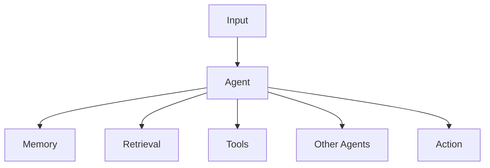

# Agent Security

AI agents combine model reasoning with capabilities such as tools, memory, external data and repeated decision loops.

The attack surface therefore extends beyond prompt handling.



## Security Objectives

Assess whether the agent:

- operates with least privilege;
- distinguishes trusted instructions from untrusted data;
- requires confirmation for sensitive actions;
- validates tool parameters;
- preserves user and tenant boundaries;
- limits autonomous loops;
- records security-relevant actions.

## Agent Components

Map:

- model;
- system instructions;
- memory;
- planning;
- retrieval;
- tools;
- credentials;
- external APIs;
- other agents;
- human approval points.

## High-Risk Capabilities

Risk increases when agents can:

- execute code;
- modify files;
- send messages;
- access confidential data;
- change infrastructure;
- perform administrative actions;
- invoke tools using privileged identities.

## Testing Principle

Test the complete action chain.

```text
Input
  |
  v
Decision
  |
  v
Tool Selection
  |
  v
Parameters
  |
  v
Authorisation
  |
  v
Action
```

## Practical Testing Workflow

1. Inventory the agent's tools, memory, retrieval sources and external identities.
2. Establish which actions should require confirmation or deterministic authorisation.
3. Introduce a benign marker through an authorised input source.
4. Observe planning, tool selection, parameters and context propagation.
5. Attempt a controlled action outside the expected permission boundary.
6. Verify that backend controls block the action independently of model behaviour.
7. Record the complete decision-to-action chain.

!!! warning "Agent reasoning is not authorisation"
    Security-sensitive actions should be authorised by deterministic application or backend controls, not by the model's decision to proceed.

## Related Pages

[Tool Abuse](tool-abuse.md)

[Multi-Agent Security](multi-agent-security.md)

[Excessive Agency](../excessive-agency.md)

[Indirect Prompt Injection](../indirect-prompt-injection.md)
