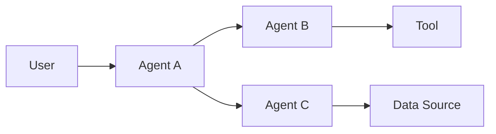

# Multi-Agent Security

Multi-agent systems introduce trust relationships between autonomous or semi-autonomous components.

A message from another agent should not automatically be considered trusted.

## Architecture



## Trust Questions

Determine:

- which agents can communicate;
- how agent identity is established;
- which messages are trusted;
- what context is shared;
- which tools each agent can access;
- whether delegation changes privileges;
- whether one compromised agent can influence another.

## Security Boundaries

Review:

- agent-to-agent authentication;
- message integrity;
- delegation;
- context propagation;
- memory sharing;
- tool permissions;
- tenant isolation.

## Controlled Validation

Use unique markers to track information flow between agents.

```text
AGENT_A_TEST_1942
```

Observe where the marker propagates and whether it crosses an unintended boundary.

## Risk

Potential impact includes:

- privilege propagation;
- indirect prompt injection;
- unauthorised tool use;
- cross-agent data leakage;
- confused-deputy behaviour;
- unintended autonomous action chains.

## Mitigation

- authenticate agents;
- treat agent messages as untrusted input;
- minimise shared context;
- restrict delegation;
- use least-privilege tools;
- enforce authorisation at every action boundary;
- log agent-to-agent actions.

## Delegation and Confused-Deputy Testing

Pay particular attention when one agent can request work from another agent with different privileges.

Assess whether:

- the receiving agent authenticates the requesting agent;
- delegated requests retain the originating user and tenant context;
- privilege is reduced or preserved explicitly during delegation;
- a lower-privilege agent can cause a higher-privilege agent to act on its behalf;
- context from one agent can silently become trusted instructions for another;
- chained delegation can bypass confirmation or policy controls.

!!! warning "Delegation must not create privilege"
    A request becoming agent-to-agent traffic should not make it more trusted or more privileged than the original request.

## Related Pages

[Agent Security](index.md)

[Tool Abuse](tool-abuse.md)

[Indirect Prompt Injection](../indirect-prompt-injection.md)
