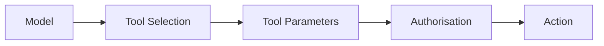

# Excessive Agency

AI systems become more security-sensitive when they can perform actions rather than only generate text.

Examples include:

- sending email;
- modifying records;
- creating or deleting files;
- executing code;
- making purchases;
- changing infrastructure;
- invoking administrative APIs.

!!! important "Authorisation belongs outside the model"
    The model may propose an action, but deterministic controls should decide whether that action is permitted.

---

## Security Model



The model should not be the sole authorisation mechanism.

---

## Three Dimensions

### Excessive Functionality

Does the agent have tools it does not need?

### Excessive Permissions

Do those tools operate with broader privileges than necessary?

### Excessive Autonomy

Can high-impact actions occur without appropriate user confirmation or deterministic checks?

---

## Assessment Questions

Determine:

- which tools are available;
- which identities the tools use;
- what permissions those identities possess;
- whether parameters are constrained;
- whether actions are reversible;
- whether user confirmation is required;
- whether backend authorisation is enforced;
- whether tool results feed back into further autonomous decisions.

---

## Controlled Validation

Use low-impact test actions first.

```text
Read Test Record
      |
      v
Modify Test Record
      |
      v
Attempt Unauthorised Test Action
```

The expected result is that the final action is blocked by deterministic controls.

---

## Agent Chains

Risk can compound across multiple steps:

```text
Untrusted Content
      |
      v
Agent Decision
      |
      v
Tool A
      |
      v
New Context
      |
      v
Tool B
      |
      v
Sensitive Action
```

Evaluate the entire chain rather than each tool in isolation.

---

## Impact

Potential impact depends on the effective privileges of the connected tools.

Examples include:

- unauthorised data access;
- unauthorised modification;
- cross-user actions;
- cross-tenant access;
- external communication;
- privileged administrative actions.

---

## Mitigation

- minimise available tools;
- use least-privilege identities;
- constrain tool parameters;
- enforce backend authorisation;
- require confirmation for sensitive actions;
- isolate high-risk tools;
- limit autonomous loops;
- log tool invocation;
- support rollback where possible.

---

## Evidence

Record:

- triggering input;
- agent decision;
- selected tool;
- parameters;
- effective identity;
- expected permission;
- actual result;
- state change;
- confirmation behaviour.

---

## Related Pages

[Prompt Injection](prompt-injection.md)

[Indirect Prompt Injection](indirect-prompt-injection.md)

[Improper Output Handling](improper-output-handling.md)
