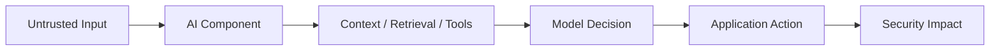
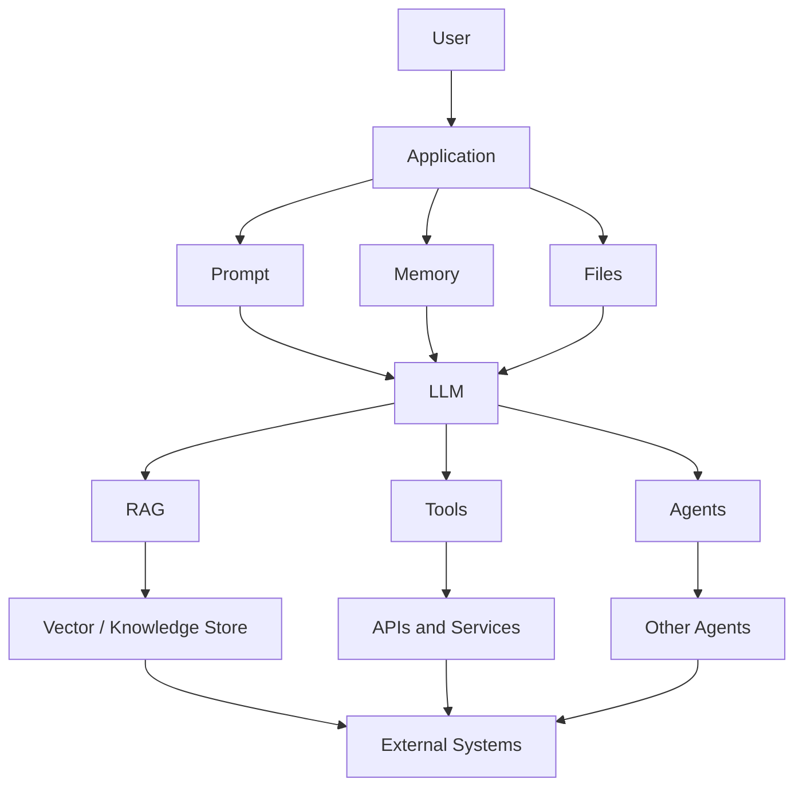

# AI Security

AI security testing evaluates the security boundaries created when applications use large language models, retrieval systems, tools, agents and external data sources.

!!! important "Core security principle"
    **Model behaviour ≠ security impact.**

    A surprising model response is not automatically a vulnerability. Testing should establish which trust boundary was crossed, what capability became available and what security impact can be reproduced.

## Core Model

!!! question "Primary testing question"
    Can untrusted content influence a security-sensitive decision, disclose protected information, invoke a privileged capability or cause unsafe downstream behaviour?

## Explore AI Security

### Core Methodology

- [AI Security Methodology](methodology.md)
- [AI Red Teaming](testing/ai-red-teaming.md)
- [AI Security Checklist](testing/ai-security-checklist.md)

### Prompt and Data Security

- [Prompt Injection](prompt-injection.md)
- [Indirect Prompt Injection](indirect-prompt-injection.md)
- [Sensitive Information Disclosure](sensitive-information-disclosure.md)
- [System Prompt Exposure](system-prompt-exposure.md)

### Application Security

- [Improper Output Handling](improper-output-handling.md)
- [Excessive Agency](excessive-agency.md)

### Retrieval-Augmented Generation

- [RAG Security](rag/index.md)
- [Retrieval Manipulation](rag/retrieval-manipulation.md)
- [Knowledge Base Poisoning](rag/knowledge-base-poisoning.md)

### Agents and Tools

- [Agent Security](agents/index.md)
- [Tool Abuse](agents/tool-abuse.md)
- [Multi-Agent Security](agents/multi-agent-security.md)

### Model Context Protocol

- [MCP Security](mcp/index.md)
- [MCP Servers](mcp/mcp-servers.md)
- [Tool Trust](mcp/tool-trust.md)

### Model and Supply Chain

- [Model Supply Chain](model-supply-chain/index.md)
- [Model and Dependency Trust](model-supply-chain/model-and-dependency-trust.md)

## AI Attack Surface

A modern AI application may include considerably more than a model.

Each connection can create a trust boundary that needs independent security controls.

## Testing Principle

!!! warning "Do not equate jailbreaks with vulnerabilities"
    A jailbreak or unexpected response is **behaviour**, not automatically a security finding.

A supported finding should establish:

1. attacker-controlled or otherwise untrusted input;
2. an affected trust boundary;
3. security-sensitive behaviour;
4. reproducible impact.

## AI Security vs AI-Assisted Security

**AI Security** tests AI-enabled applications themselves: prompt injection, RAG security, agent security, tool abuse, excessive agency and sensitive data exposure.

**AI-Assisted Security** uses AI to support security testing: source-code analysis, payload reasoning, log analysis, vulnerability research and reporting assistance.

[AI-Assisted Security Tools](../tools/ai/index.md)

## Evidence

Useful evidence includes:

- exact input and relevant conversation context;
- retrieved content and provenance;
- tool calls and parameters;
- affected identity and effective permissions;
- application response and downstream action;
- resulting state change;
- reproduction rate;
- relevant logs.

## Related Sections

- [Web Application Security](../web/index.md)
- [Source Code Review](../source-code-review/index.md)
- [Red Teaming](../red-teaming/index.md)
- [AI-Assisted Security Tools](../tools/ai/index.md)
