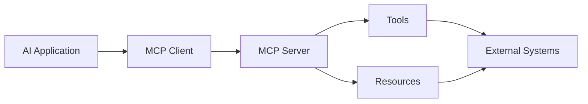

# MCP Security

The Model Context Protocol (MCP) provides a structured way for AI applications to interact with external tools, resources and services.

From a security perspective, MCP expands the model's reachable attack surface.

## Architecture

## Assessment Objectives

Identify:

- MCP servers;
- exposed tools;
- resources;
- prompts;
- authentication;
- credentials;
- permissions;
- transport security;
- server trust;
- tool trust.

## Security Questions

- Who can configure MCP servers?
- How is a server authenticated?
- What privileges does each server possess?
- Can untrusted content influence tool selection?
- Can tools access resources outside their intended scope?
- Are tool parameters validated?
- Can a malicious server return hostile instructions or data?

## Principle

!!! important "Connected ≠ trusted"
    Treat MCP servers, tools, resources and their outputs according to their actual trust level. Connectivity is not evidence of provenance, integrity or appropriate privilege.

## MCP Trust Boundaries

Review MCP as a chain of independent trust decisions:

1. **Server provenance** — who supplied and controls the server?
2. **Configuration** — who can add, replace or modify the server definition?
3. **Authentication** — how does the client authenticate the server and vice versa?
4. **Credential scope** — which identity and permissions does the server use?
5. **Tool metadata** — can descriptions or schemas influence unsafe tool selection?
6. **Tool execution** — are parameters and resource ownership validated?
7. **Returned content** — can tool or resource output inject instructions into model context?

Test local and remote MCP servers according to their actual deployment and trust model.

## Related Pages

[MCP Servers](mcp-servers.md)

[Tool Trust](tool-trust.md)

[Tool Abuse](../agents/tool-abuse.md)

[Excessive Agency](../excessive-agency.md)
