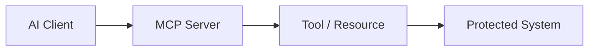

# MCP Servers

An MCP server may expose tools and resources to an AI application.

Its effective privileges can determine the impact of an AI security weakness.

## Inventory

For every server record:



## Assessment Areas

Review:

- server origin;
- configuration;
- authentication;
- transport;
- credentials;
- exposed tools;
- exposed resources;
- effective operating-system or service identity;
- update and dependency process.

## Trust Boundary

```text
AI Client
   |
   v
MCP Server
   |
   v
Tool / Resource
   |
   v
Protected System
```

Each boundary should have explicit security controls.

## Security Questions

- Can an unauthorised server be added?
- Can server configuration be modified?
- Does the server expose unnecessary tools?
- Are credentials over-privileged?
- Can resources expose sensitive data?
- Are actions independently authorised?
- Are server responses treated as trusted instructions?

## Mitigation

- allowlist trusted servers;
- use least-privilege credentials;
- minimise exposed capabilities;
- authenticate connections;
- protect configuration;
- validate tool arguments;
- monitor server changes;
- log security-sensitive calls.

## Configuration and Replacement

Treat MCP configuration as security-sensitive.

Verify:

- where server definitions are stored;
- who can modify command, arguments, environment variables or remote endpoints;
- whether an approved server can be silently replaced;
- whether local server executables or dependencies are writable by lower-privilege users;
- whether credentials are embedded directly in configuration;
- whether remote endpoints use appropriate transport and authentication controls.

## Practical Validation

Use a controlled server or test resource to verify the expected boundary without exposing real secrets.

Record the server identity, configuration source, effective credentials, exposed capabilities and the resulting backend request.

## Related Pages

[MCP Security](index.md)

[Tool Trust](tool-trust.md)
