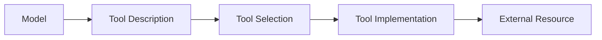

# Tool Trust

Tools should be evaluated as security-sensitive integrations rather than simple model extensions.

A tool may access systems that the model itself cannot directly reach.

## Trust Model



## Assessment Questions

- Who developed the tool?
- Who controls its configuration?
- What identity does it use?
- What resources can it access?
- Can its description or metadata be modified?
- Are inputs validated?
- Are outputs trusted by the model?
- Can it perform write operations?
- Is provenance retained?

## Tool Metadata

Tool descriptions influence how an AI system selects and uses capabilities.

Treat descriptions and schemas as security-relevant configuration.

## Output Trust

Tool output may itself contain untrusted data.

```text
External System
      |
      v
Tool Output
      |
      v
Model Context
```

Do not automatically treat tool output as trusted instructions.

## Mitigation

- review tool provenance;
- protect tool definitions;
- minimise privileges;
- constrain inputs;
- validate outputs where appropriate;
- separate read and write operations;
- enforce backend authorisation;
- log sensitive actions.

## Description and Schema Manipulation

Tool names, descriptions and schemas can influence tool selection and argument generation.

Assess whether a lower-trust party can:

- rename a tool;
- alter its description;
- change parameter descriptions or defaults;
- broaden accepted resource identifiers;
- make a write-capable tool appear read-only;
- return output that is subsequently interpreted as instructions.

Protect tool metadata with the same care as other security-relevant configuration.

## Related Pages

[MCP Security](index.md)

[MCP Servers](mcp-servers.md)

[Tool Abuse](../agents/tool-abuse.md)
