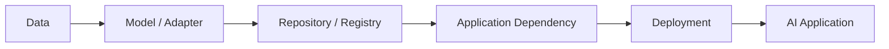

# Model Supply Chain

AI applications depend on a supply chain that may include models, datasets, libraries, adapters, containers and third-party services.

Compromise or untrusted changes within this chain can affect the application before runtime testing begins.

## Supply Chain



## Components

Review:

- model sources;
- model versions;
- adapters;
- fine-tunes;
- datasets;
- tokenisers;
- libraries;
- containers;
- registries;
- external APIs;
- build pipelines.

## Security Questions

- Is the model source trusted?
- Are versions pinned?
- Are artefacts verified?
- Can dependencies change unexpectedly?
- Are third-party models reviewed?
- Are credentials embedded in artefacts?
- Is provenance documented?
- Can untrusted updates reach production?

## Evidence

Record:

```text
Component:
Source:
Version:
Integrity Verification:
Owner:
Update Process:
Deployment Location:
Trust Decision:
```

## Mitigation

- maintain provenance;
- pin versions;
- verify artefact integrity;
- restrict registries;
- scan dependencies;
- protect build pipelines;
- review third-party components;
- monitor unexpected changes.

## Related Pages

[Model and Dependency Trust](model-and-dependency-trust.md)

[AI Security Methodology](../methodology.md)
