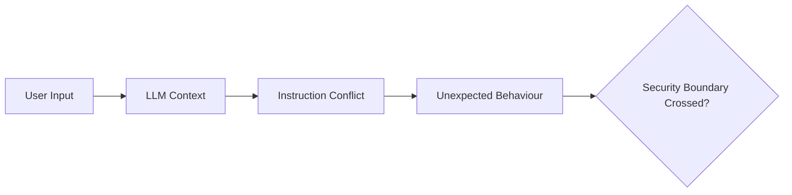

# Prompt Injection

Prompt injection occurs when untrusted input changes how an AI system interprets or follows instructions.

The core security issue is not simply that a model can be persuaded.

The important question is whether attacker-controlled instructions can cross an intended trust boundary.

---

## Direct Prompt Injection

Direct prompt injection originates from input intentionally supplied by the user.



---

## What to Identify

Determine:

- which inputs reach the model;
- how system and user instructions interact;
- what hidden context exists;
- what data the model can access;
- which tools the model can invoke;
- whether actions require confirmation;
- whether authorisation is enforced outside the model.

---

## Safe Initial Testing

Begin with benign instruction conflicts.

For example, test whether the application follows an instruction to return a unique harmless marker rather than performing the expected task.

```text
AI_PROMPT_TEST_42
```

The objective is to determine instruction influence without accessing secrets or invoking destructive actions.

---

## Escalation Model

```text
Instruction Influence
       |
       v
Application Restriction Bypass?
       |
       v
Protected Data Accessible?
       |
       v
Tool Invocation Influenced?
       |
       v
Authorisation Boundary Crossed?
```

---

## Impact Questions

Ask:

- Can the injection reveal protected application data?
- Can it bypass an application-level restriction?
- Can it influence a privileged tool call?
- Can it act using another user's authority?
- Can it modify stored data?
- Can it affect downstream systems?
- Can it cross tenant boundaries?

---

## Important Distinction

!!! important "Behaviour ≠ vulnerability"
    An unexpected model response is not a confirmed security vulnerability. A meaningful finding requires a demonstrable security consequence.

---

## Validation

Capture:

- exact prompt;
- application state;
- user role;
- model response;
- available tools;
- downstream requests;
- resulting state changes;
- reproducibility.

---

## Mitigation

Controls may include:

- enforce authorisation outside the model;
- minimise model privileges;
- separate trusted instructions from untrusted data;
- constrain tool schemas;
- require confirmation for sensitive actions;
- validate tool parameters;
- isolate tenants;
- classify external content;
- monitor unusual tool invocation patterns.

Prompt-only defences should not be treated as complete security boundaries.

---

## Related Pages

[Indirect Prompt Injection](indirect-prompt-injection.md)

[Excessive Agency](excessive-agency.md)

[AI Security Methodology](methodology.md)
