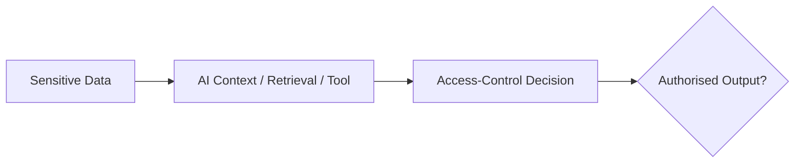

# Sensitive Information Disclosure

AI applications may process information that should not be exposed to every user or model interaction.

Examples include:

- credentials;
- API keys;
- personal information;
- internal documents;
- proprietary data;
- hidden application context;
- cross-tenant information;
- confidential conversation history.

---

## Security Model



The security boundary should be enforced by the application and underlying data systems.

Do not rely on asking the model to keep information secret.

---

## Assessment Questions

Determine:

- what sensitive data reaches the model;
- which users are authorised to access it;
- whether retrieval respects permissions;
- whether tenants are isolated;
- whether logs retain sensitive prompts;
- whether tools expose excessive response data;
- whether secrets appear in errors or debugging context.

---

## Safe Validation

Use synthetic secrets or controlled test records where possible.

For example:

```text
AI_TEST_SECRET_8F21
```

Assign the marker to a test resource that one authorised identity can access and another cannot.

Then verify whether the application preserves the expected boundary.

---

## Common Failure Patterns

Potential issues include:

- retrieval without user-level ACL enforcement;
- cross-tenant context contamination;
- excessive tool responses;
- secrets embedded in prompts;
- sensitive debugging output;
- insecure conversation sharing;
- unintended persistence in memory or logs.

---

## System Prompts

System instructions can contain security-relevant implementation information.

!!! note "System prompt exposure ≠ sensitive data exposure"
    The actual contents determine the impact. Exposure becomes security-relevant when the prompt contains protected information or enables another security-sensitive action.

See:

[System Prompt Exposure](system-prompt-exposure.md)

---

## Mitigation

Consider:

- data minimisation;
- deterministic access controls;
- tenant isolation;
- retrieval-time ACL enforcement;
- secret management;
- reduced logging of sensitive data;
- short-lived credentials;
- least-privilege tool responses.

---

## Evidence

Record:

- identity;
- expected access;
- actual access;
- source of disclosed data;
- data classification;
- retrieval or tool path;
- reproducibility.

---

## Related Pages

[AI Security Methodology](methodology.md)

[Prompt Injection](prompt-injection.md)

[System Prompt Exposure](system-prompt-exposure.md)
