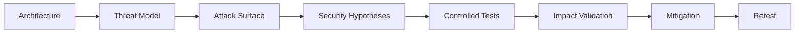

# AI Red Teaming

AI red teaming applies adversarial testing to AI-enabled systems to identify weaknesses in trust boundaries, permissions, data handling and autonomous behaviour.

It should extend beyond jailbreak testing.

## Assessment Model



## Test Areas

Include:

- direct prompt injection;
- indirect prompt injection;
- sensitive information disclosure;
- retrieval security;
- knowledge poisoning;
- output handling;
- agent security;
- tool permissions;
- MCP;
- supply-chain trust;
- cross-user and cross-tenant boundaries.

## Test Design

Each test should define:

```text
Objective:
Precondition:
Input:
Expected Security Control:
Observed Behaviour:
Impact:
Evidence:
Reproducibility:
```

## Reproducibility

Model behaviour may vary between runs.

For important findings:

- repeat the test;
- preserve model/version information where available;
- record relevant context;
- distinguish deterministic application behaviour from probabilistic model behaviour.

## Impact Validation

Prioritise security impact over unusual model responses.

```text
Interesting Behaviour
        |
        v
Security Boundary?
        |
   +----+----+
   |         |
  No        Yes
   |         |
   v         v
Document   Validate
Carefully   Impact
```

## Reporting

A useful finding should identify:

- affected component;
- trust boundary;
- preconditions;
- reproducible behaviour;
- security consequence;
- evidence;
- root cause;
- remediation.

## Related Pages

[AI Security Methodology](../methodology.md)

[AI Security Checklist](ai-security-checklist.md)

[Prompt Injection](../prompt-injection.md)

[Agent Security](../agents/index.md)
