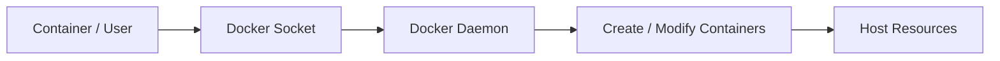

# Docker Socket

The Docker Unix socket commonly exposes the Docker daemon API:

```text
/var/run/docker.sock
```

Access to the socket can provide extensive control over containers and, depending on daemon configuration, the host.

## Detection

```bash
ls -l /var/run/docker.sock
docker ps
docker info
```

## Security Boundary



!!! danger "Treat daemon access as highly privileged"
    A user able to control a privileged Docker daemon may be able to create workloads with host mounts, broad capabilities or other access that crosses the original container boundary.

## Assessment Questions

Determine whether the socket is mounted, who can access it, whether the daemon is rootful/rootless, whether a TCP API is exposed, whether container creation/configuration is possible and whether authorisation controls exist.

## Safe Validation

Begin with read-only queries. Only create or modify a controlled test workload when authorised and necessary to prove impact.

## Mitigation

- do not mount the Docker socket into ordinary workloads;
- restrict daemon access;
- minimise membership of privileged runtime groups;
- protect remote daemon endpoints;
- use narrowly scoped intermediary services where required;
- monitor daemon activity.

## Related Pages

- [Docker Security](index.md)
- [Docker Enumeration](enumeration.md)
- [Container Escape](container-escape.md)
