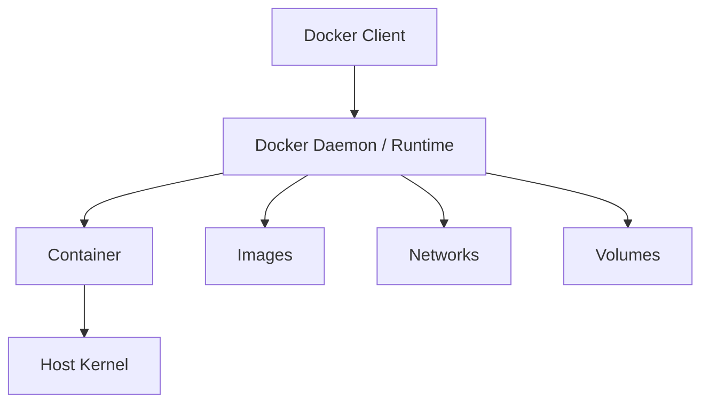

# Docker Security

Docker packages workloads into containers while sharing the host kernel. Assess both the container and the runtime boundary between the container and host.

## Architecture

## Security Objectives

Assess whether containers run with least privilege, runtime control is restricted, dangerous host resources are not mounted, capabilities are minimised, images are trusted and secrets are not embedded.

## High-Risk Conditions

Pay particular attention to:

- `--privileged`;
- Docker socket mounts;
- host filesystem mounts;
- host PID or network namespaces;
- excessive capabilities;
- writable sensitive mounts;
- device access;
- containers running as root;
- exposed daemon APIs.

!!! warning "Runtime control can become host control"
    Access to a privileged container runtime interface may allow creation or modification of workloads with access to host resources.

## Practical Workflow

1. Enumerate runtime and container configuration.
2. Record user, capabilities, namespaces and mounts.
3. Identify exposed sockets or APIs.
4. Review image source and build configuration.
5. Form a specific isolation or privilege hypothesis.
6. Validate the minimum action needed to prove impact.
7. Record the affected host or workload boundary.

## Related Pages

- [Docker Enumeration](enumeration.md)
- [Container Escape](container-escape.md)
- [Docker Socket](docker-socket.md)
- [Image Security](image-security.md)
