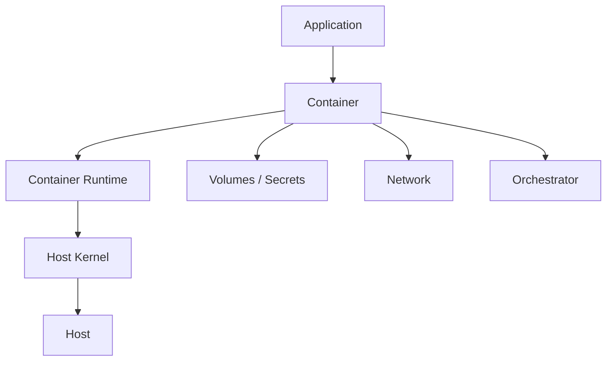

# Containers and Kubernetes

Container security testing evaluates the boundaries between applications, container runtimes, images, orchestration platforms and the underlying host.

!!! important "Core security principle"
    **A container is an isolation boundary, not automatically a security boundary.**

    Security depends on runtime configuration, kernel controls, privileges, mounted resources, identities and orchestration policy.

## Security Model

## Explore

### Core Methodology

- [Container Security Methodology](methodology.md)

### Docker

- [Docker Security](docker/index.md)
- [Docker Enumeration](docker/enumeration.md)
- [Container Escape](docker/container-escape.md)
- [Docker Socket](docker/docker-socket.md)
- [Image Security](docker/image-security.md)

### Kubernetes

- [Kubernetes Security](kubernetes/index.md)
- [Kubernetes Enumeration](kubernetes/enumeration.md)
- [RBAC](kubernetes/rbac.md)
- [Service Accounts](kubernetes/service-accounts.md)
- [Pod Security](kubernetes/pod-security.md)

## Attack Surface

Review:

- container image and build process;
- runtime configuration;
- Linux capabilities;
- namespaces and cgroups;
- mounted files and volumes;
- runtime sockets;
- secrets and credentials;
- workload identity;
- network exposure;
- Kubernetes API access;
- RBAC;
- service accounts;
- pod security settings;
- node and host access.

!!! warning "Do not stop at the container"
    A finding inside a container becomes more significant when it enables access to the host, another workload, sensitive credentials, the orchestration API or a higher-privilege identity.

## Evidence

Record container and image identity, effective user, capabilities, mounts, runtime configuration, credentials, service account, Kubernetes permissions, pod security context and resulting host or cluster access.

## Related Sections

- [Linux](../linux/index.md)
- [Linux Privilege Escalation](../linux/privilege-escalation.md)
- [Secrets Exposure](../web/secrets-exposure.md)
- [Dependency Security](../web/dependency-security.md)
