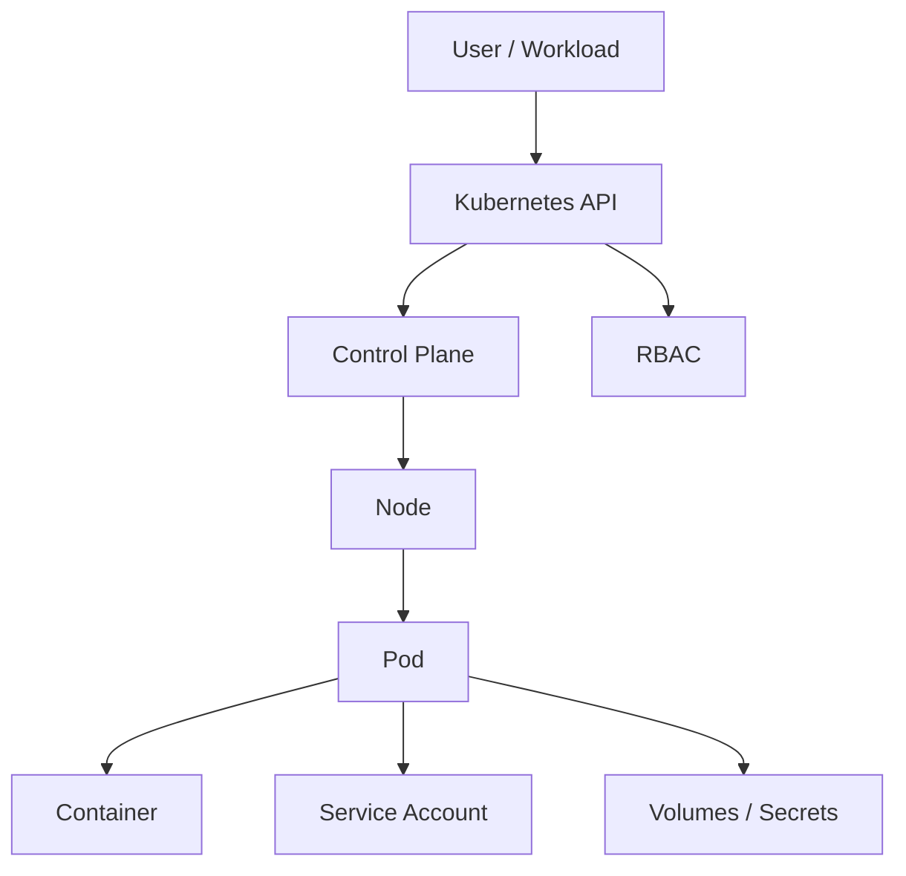

# Kubernetes Security

Kubernetes adds an orchestration and identity layer around containerised workloads. Distinguish workload compromise from access to the Kubernetes API, node, other namespaces and cluster-wide resources.

## Architecture

## Security Objectives

Assess least privilege for Kubernetes identities, RBAC boundaries, service-account scope, pod security contexts, privileged workloads, host-resource exposure, secrets and node/API access.

## High-Risk Areas

Prioritise cluster-admin or wildcard permissions, privileged pods, hostPath, host namespaces, dangerous capabilities, service-account tokens, workload creation/modification, role binding, secrets and node access.

!!! important "Kubernetes is an authorisation system"
    Determine what the Kubernetes identity can request and whether the API server authorises those requests.

## Practical Workflow

1. Establish cluster and namespace context.
2. Identify the current Kubernetes identity.
3. Enumerate API permissions.
4. Review service accounts and bindings.
5. Review pod security contexts and host interaction.
6. Identify privilege paths.
7. Validate using controlled resources.
8. Record the exact API permission or configuration that enabled impact.

## Related Pages

- [Kubernetes Enumeration](enumeration.md)
- [RBAC](rbac.md)
- [Service Accounts](service-accounts.md)
- [Pod Security](pod-security.md)
