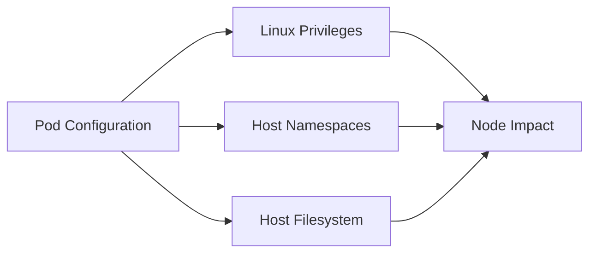

# Kubernetes Pod Security

Pod configuration controls how a workload interacts with the node, kernel and surrounding cluster. A secure workload should receive only the host access and Linux privileges required.

## Security Context

```bash
kubectl get pod <pod> -o yaml
```

Review pod-level and container-level `securityContext` settings.

## Key Controls

Assess `privileged`, `runAsUser`, `runAsNonRoot`, `allowPrivilegeEscalation`, capabilities, seccomp, read-only root filesystem, hostPID, hostIPC, hostNetwork, hostPath and device access.

## Risk Model



## Privileged Workloads

Privileged containers receive substantially reduced isolation from the host. Determine why the privilege is required.

## Host Namespaces

Review:

```yaml
hostPID: true
hostNetwork: true
hostIPC: true
```

## HostPath

Review source path, mount destination, read/write mode, pod identity and sensitivity of the host resource.

## Capabilities

Prefer dropping capabilities and adding back only those required.

See [Linux Capabilities](../../linux/capabilities.md).

## Pod Security Standards

Kubernetes Pod Security Standards define **Privileged**, **Baseline** and **Restricted** profiles. Compare workload configuration with the organisation's intended policy and determine whether enforcement matches that expectation.

## Validation

Prefer configuration evidence and read-only inspection. If a boundary must be demonstrated, use a controlled pod or test namespace rather than modifying production workloads.

## Mitigation

- avoid privileged containers;
- run as non-root where practical;
- disable unnecessary privilege escalation;
- drop unnecessary capabilities;
- avoid host namespace sharing;
- restrict hostPath;
- use seccomp and mandatory access controls;
- enforce appropriate pod security through supported admission controls.

## Related Pages

- [Kubernetes Security](index.md)
- [Kubernetes Enumeration](enumeration.md)
- [RBAC](rbac.md)
- [Container Escape](../docker/container-escape.md)
