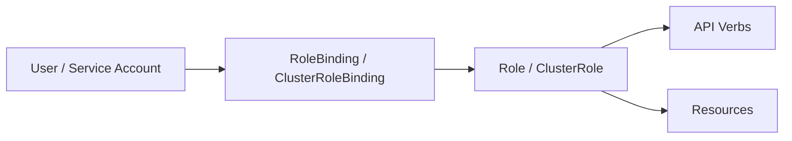

# Kubernetes RBAC

Role-Based Access Control (RBAC) determines which Kubernetes API actions an identity may perform. Evaluate effective permissions rather than role names alone.

## RBAC Model



## Core Objects

- `Role` — permissions within a namespace;
- `ClusterRole` — cluster-scoped permission definition;
- `RoleBinding` — binds a role to subjects within a namespace;
- `ClusterRoleBinding` — binds cluster-level permissions to subjects.

## Enumeration

```bash
kubectl auth can-i --list
kubectl get roles
kubectl get rolebindings
kubectl get clusterroles
kubectl get clusterrolebindings
```

```bash
kubectl describe rolebinding <name>
kubectl describe clusterrolebinding <name>
```

## High-Impact Permissions

Review identities that can read secrets, create/modify pods, use `pods/exec`, create/modify role bindings, modify roles, impersonate identities or access node/security-sensitive resources. Wildcards deserve particular attention.

## Privilege Paths


Whether a path works depends on admission controls, namespace policy, service-account configuration and other controls.

## Validation

Use `kubectl auth can-i` before changing resources. Where a privilege path must be demonstrated, prefer a dedicated test namespace or controlled resource.

## Mitigation

- apply least privilege;
- avoid wildcard permissions;
- restrict role and binding creation;
- restrict privileged workload creation;
- separate administrative identities;
- audit effective permissions.

## Related Pages

- [Kubernetes Enumeration](enumeration.md)
- [Service Accounts](service-accounts.md)
- [Pod Security](pod-security.md)
