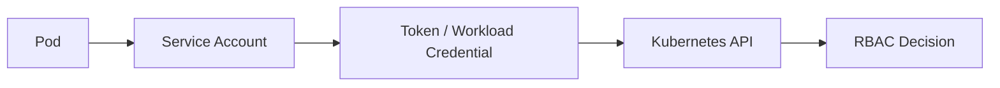

# Kubernetes Service Accounts

A Kubernetes service account provides an identity that workloads can use when communicating with the Kubernetes API. Its impact depends on permissions bound to that identity.

## Workload Identity



## Identify the Service Account

```bash
kubectl get pod <pod> -o jsonpath='{.spec.serviceAccountName}'
```

Inside a workload, service-account material is commonly mounted beneath:

```text
/var/run/secrets/kubernetes.io/serviceaccount/
```

Exact behaviour depends on Kubernetes version and workload configuration.

## Assessment Questions

Determine the service account, whether automounting is required, bound roles, token type/lifetime, whether API access is needed and whether the identity can access secrets, create workloads, bind roles or impersonate identities.

## Permission Review

```bash
kubectl auth can-i --list
kubectl auth can-i get secrets
kubectl auth can-i create pods
kubectl auth can-i create rolebindings
```

## Token Handling

Do not copy service-account tokens into reports or notes. Record the identity, token type and effective permissions instead.

!!! warning "Token possession is not the final impact"
    A service-account token becomes significant when its effective RBAC permissions allow access beyond the intended workload boundary.

## Mitigation

- use dedicated service accounts;
- avoid unnecessary token automounting;
- apply least-privilege RBAC;
- avoid broad cluster-wide bindings;
- use short-lived projected tokens where appropriate;
- protect workload filesystems and logs;
- monitor API use by workload identities.

## Related Pages

- [Kubernetes Security](index.md)
- [Kubernetes Enumeration](enumeration.md)
- [RBAC](rbac.md)
