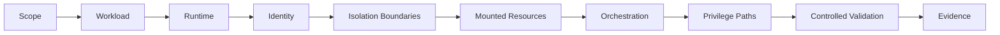
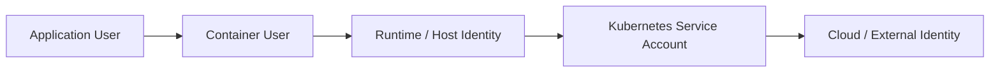

# Container Security Methodology

Container assessments should begin by identifying the workload, runtime, identity and isolation boundaries before testing individual techniques.

## Assessment Flow



## 1. Establish Scope

Identify hosts, nodes, runtimes, registries, images, containers, pods, namespaces, clusters, managed services and authorised identities.

## 2. Identify the Runtime

```bash
docker version
docker info
```

Inside a Linux workload:

```bash
cat /proc/1/cgroup
cat /proc/self/status
mount
```

Determine runtime/version, rootful or rootless operation, host OS, socket exposure, namespace configuration and security profiles.

## 3. Establish Identity

```bash
id
whoami
```

For Kubernetes, also determine the workload's service account and effective API permissions.



## 4. Map Isolation Boundaries

Review user, PID, network and mount namespaces, Linux capabilities, seccomp, AppArmor or SELinux, privileged mode and host namespace sharing.

## 5. Review Mounted Resources

```bash
mount
findmnt
```

Look for host filesystem mounts, runtime sockets, configuration, secrets, credentials, writable shared volumes and sensitive device access.

## 6. Review Orchestration Access

For Kubernetes workloads, determine whether credentials or configuration allow access to the Kubernetes API. Test permissions before assuming compromise of a service account provides meaningful cluster access.

## 7. Build Privilege Hypotheses

Examples:

```text
Writable Runtime Socket -> Runtime Control -> Host-Level Impact
Over-Privileged Service Account -> Kubernetes API -> Higher-Privilege Workload
Privileged Pod + Host Mount -> Host Resource Access
```

## 8. Validate Safely

Prefer read-only enumeration and controlled test resources first. Demonstrate the minimum action required to establish the boundary.

## 9. Determine Root Cause

Common root causes include excessive privileges, dangerous mounts, exposed runtime sockets, weak image provenance, over-broad RBAC, unnecessary service-account access and insecure pod security contexts.

## 10. Record Evidence

```text
Workload:
Image:
Runtime:
Container User:
Capabilities:
Mounts:
Security Profile:
Service Account:
Kubernetes Permissions:
Affected Boundary:
Validation:
Impact:
```

## Related Pages

- [Docker Enumeration](docker/enumeration.md)
- [Container Escape](docker/container-escape.md)
- [Kubernetes Enumeration](kubernetes/enumeration.md)
- [RBAC](kubernetes/rbac.md)
- [Pod Security](kubernetes/pod-security.md)
